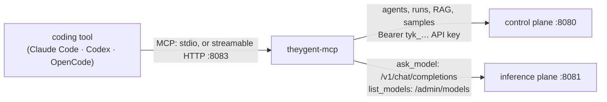

# MCP server

`apps/mcp-server` (`theygent-mcp`) turns TheYgent's platform into tools a coding agent can call.
Claude Code, Codex, OpenCode or any MCP client gets twenty tools. With them it can offload a
prompt to a local model, run and build agents, and index and search retrieval sources. The user
guide is [Use TheYgent from coding agents](../user-docs/content/coding-agents/index.md).

## Place in the system

The server is a **client of both planes**, in the same position as the interface:

- **It runs on the developer's machine.** The coding tool launches it over stdio with
  `uv run --project <checkout> --package theygent-mcp theygent-mcp`. `--project`, unlike
  `--directory`, keeps the tool's working directory. That keeps `add_rag_files`'s relative
  paths and the names files are indexed under relative to the project being worked on.
  `--http` serves streamable HTTP on `127.0.0.1:8083` for clients that can't launch processes.
- **It holds no state.** All state lives in the planes. A restart loses nothing.
- **It uses only public HTTP APIs.** It never imports `theygent_control_plane` or
  `theygent_inference_plane` and never touches their databases or state directories.
  `theygent_ir` is the one shared package: `validate_agent` runs `parse_document` +
  `validate_graph` locally, and the authoring guide reads `EXECUTABLE_TYPES`, `NODE_TYPE_KIND`
  and the generated `packages/ir-types/src/node-types.json` for each type's ports and config
  schema. The guide therefore cannot drift from the node set the runtime accepts.
- **The plane boundary for data holds.** `ask_model` posts straight to the inference plane's
  `/v1/chat/completions` and sends no control-plane credential, so prompts never transit the
  control plane. Agent runs and retrieval go through the control plane, as they do from the
  interface. Those runs are ordinary runs, traced on the Runs page.

## Authentication

Control-plane calls carry `Authorization: Bearer $THEYGENT_API_KEY`, a personal API key (`tyk_…`).
It acts with its owner's role, narrowed at use (see
[control-plane.md](./control-plane.md)). There is no MCP-specific credential and no new
auth surface. Calls to the inference plane carry no credential. The inference plane does not
authenticate its callers, whether the caller is the interface, the AI gateway, or this server.

The server never logs or returns the key. Without a key, the model tools still work. Every other
tool raises a `ToolError` that says where to create one, before any request is sent.

## The tools

| Group | Tools | Plane endpoints |
|---|---|---|
| Models | `list_models`, `ask_model` | `GET /admin/models`, `POST /v1/chat/completions` |
| Agents & runs | `list_agents`, `get_agent`, `run_agent`, `run_graph`, `get_run` | `GET /agents`, `GET /agents/{id}`, `GET /agents/{id}/versions/{v}`, `POST /agents/{id}/runs`, `POST /graphs/runs`, `GET /runs/{id}` |
| Authoring | `agent_authoring_guide`, `validate_agent`, `create_agent`, `publish_agent_version`, `list_samples`, `install_samples` | local; `POST /agents`, `POST /agents/{id}/versions`, `GET /samples`, `POST /samples/install` |
| Retrieval | `list_rag_sources`, `create_rag_source`, `add_rag_files`, `add_rag_text`, `ingest_rag_source`, `get_rag_source`, `search_rag` | `/rag/sources[/{id}[/documents \| /query \| :ingest]]` |

Design rules for the tools:

- **Results are trimmed for a model's context.** Runs return `run_id`, `status`, `output`.
  `ask_model` returns the model's reasoning only when it produced no answer, as the tail
  needed to explain a token cap. `add_rag_files` lists per-file results in full only for small
  batches; past 50 files it lists only the misses.
- **References resolve by id or name.** Coding agents know agents and sources by the names
  users give them. `_agent_id` and `_source_id` map an exact, case-insensitive name to its id
  and fail loudly when the name is ambiguous. An unknown source name lists the real ones.
- **Errors are actionable.** `Planes._send` maps an unreachable plane to "start TheYgent / set
  the URL", `401` to "make a new key", and `403` to "needs editor". Other errors pass the
  plane's envelope `{"error": {"code", "message"}}` through with its code.
- **Runs are synchronous and bounded.** `run_agent` and `run_graph` call the non-streaming,
  in-process run endpoints and wait up to `THEYGENT_MCP_RUN_TIMEOUT_S` (default 600 s). The
  durable-only nodes (human, subgraph, loop, map) are therefore out of reach of these tools.
  `get_run` reads any run by id, including durable runs started elsewhere.
- **`ask_model`'s `files` stay out of the caller's context.** The server reads them and
  appends them to the prompt as fenced blocks. It caps them at `MAX_INLINE_BYTES` (256 KiB)
  and refuses binaries. Only the model's answer goes back to the coding tool. This is the
  point of the parameter: a log the coding agent never reads never enters its context.
- **`ask_model`'s `think`** sets `chat_template_kwargs.enable_thinking`. The inference
  plane forwards it to the engines' chat templates. It is sent only when the caller sets it,
  so remote APIs that reject unknown fields never see it.

### Indexing local files

`add_rag_files` reads files on the MCP server's machine and uploads each one through the
regular raw-body upload (`POST /rag/sources/{id}/documents?filename=…`).

- **What gets uploaded.** Paths may be files, directories or glob patterns. Directory walks skip
  hidden entries and dependency, build and cache directories (`node_modules`, `__pycache__`,
  `dist`, `build`, `target`, …). Empty files are skipped locally. Each call stops at 500 files.
- **How files are named.** The upload `filename` is the file's path relative to the working
  directory when the file lies inside it, or its basename otherwise. That name becomes the
  document's `uri`, so same-named files in different directories stay separate documents, and
  re-adding a file replaces its earlier copy.
- **Supported types are the control plane's.** A `422 unsupported_document` is reported per
  file as skipped, and the batch continues. Source code and config are in the control plane's
  plain-text set (`rag/parse.py`), so a codebase indexes without a converter.

## Configuration

`Config.from_env()` reads the environment; empty means unset. The variables are
`THEYGENT_API_KEY`, `THEYGENT_CONTROL_PLANE_URL` (default `http://127.0.0.1:8080`),
`THEYGENT_INFERENCE_PLANE_URL` (default `http://127.0.0.1:8081/v1`, the `/v1` root, the same
convention as the worker; `/admin` is derived beside it), `THEYGENT_MCP_DEFAULT_MODEL`, and
`THEYGENT_MCP_RUN_TIMEOUT_S`. `theygent-mcp setup [claude|codex|opencode]` (`make mcp-setup`)
prints each client's configuration with the checkout path filled in.

## Tests

`uv run --package theygent-mcp pytest` drives every tool through an in-memory
`fastmcp.Client` against fake planes answered by an `httpx.MockTransport`. Each test checks
both what the tool returns and the exact request it sent: path, body, headers, and the absence
of credentials on inference calls. The suite needs no running planes, so it runs in CI's fast
job.

The live path is exercised by hand. Start the stack (`make up`), register a chat and an
embeddings model, then drive the server over stdio with a `fastmcp.Client` or a real coding
tool.
